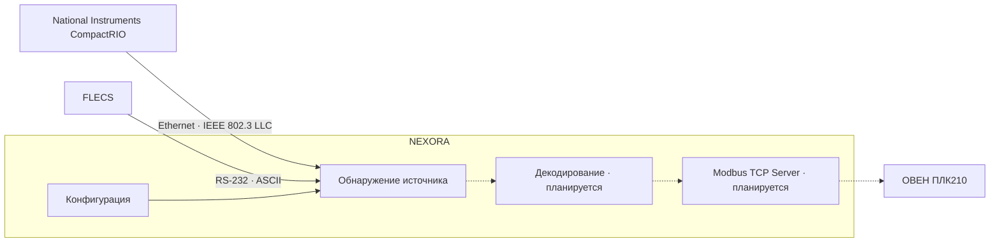

# NEXORA

**Industrial Data Gateway · Rust**

NEXORA — программный промышленный шлюз для пассивного получения технологических данных от оборудования National Instruments CompactRIO и систем FLECS.

Проект предназначен для интеграции существующего оборудования с промышленными контроллерами без изменения штатного обмена с системой iCem.

> [!NOTE]
> **Статус: в разработке.** Реализованы конфигурирование и автоматическое обнаружение источника данных.

## Содержание

- [Назначение](#назначение)
- [Архитектура системы](#архитектура-системы)
- [Реализованные возможности](#реализованные-возможности)
- [Сборка и запуск](#сборка-и-запуск)
- [Конфигурация](#конфигурация)
- [Обнаружение источника](#обнаружение-источника)
- [Проверка FLECS](#проверка-flecs)
- [Структура проекта](#структура-проекта)
- [Технологии](#технологии)
- [Дальнейшая разработка](#дальнейшая-разработка)
- [Проверка проекта](#проверка-проекта)
- [Ограничения](#ограничения)

## Назначение

NEXORA работает на промышленном компьютере и анализирует данные, поступающие по одному из двух интерфейсов:

| Источник | Интерфейс и протокол | Способ получения данных |
| :--- | :--- | :--- |
| **National Instruments CompactRIO** | Ethernet · IEEE 802.3 LLC | Копия трафика через зеркальный порт Ethernet-коммутатора |
| **FLECS** | RS-232 · ASCII | Текстовые сообщения через последовательный интерфейс |

На текущем этапе NEXORA определяет протокол входящего потока. В дальнейшем данные будут декодироваться и предоставляться внешнему контроллеру по Modbus TCP.

## Архитектура системы



Сплошные стрелки обозначают реализованные связи, пунктирные — планируемый путь обработки и передачи данных.

NEXORA не передаёт команды исходному оборудованию и не вмешивается в его штатную работу.

## Реализованные возможности

- Интерактивная настройка последовательного порта и Ethernet-интерфейсов.
- Сохранение и загрузка конфигурации `nexora.toml`.
- Параллельное обнаружение CompactRIO LLC и FLECS ASCII.
- Проверка структуры сообщений и характерных признаков протокола.
- Подтверждение источника по трём корректным сообщениям.
- Атомарная фиксация первого подтверждённого источника.
- Повторное открытие недоступных интерфейсов с интервалом 1 секунда.
- Освобождение ресурсов невыбранного интерфейса.

> [!IMPORTANT]
> После обнаружения источника текущая версия выводит результат в консоль и завершает работу. Непрерывный приём и обработка технологических параметров находятся в разработке.

## Сборка и запуск

### Требования

- Rust с поддержкой редакции 2024.
- Cargo.
- Библиотека захвата пакетов: Npcap для Windows или совместимая libpcap для Linux.
- Доступ к необходимым Ethernet- и последовательным интерфейсам.

### Сборка

```bash
cargo build --release
```

### Конфигурирование

```bash
cargo run -- --conf
```

Для запуска собранного приложения:

```bash
nexora --conf
```

Конфигуратор позволяет выбрать доступные интерфейсы и сохранить настройки.

### Штатный запуск

```bash
cargo run
```

Или после сборки:

```bash
nexora
```

Файл `nexora.toml` загружается из каталога, в котором находится исполняемый файл.

## Конфигурация

Пример `nexora.toml`:

```toml
[serial]
port = "COM2"

[ethernet]
interface = "\\Device\\NPF_{YOUR-ADAPTER-GUID}"

[modbus]
interface = "localhost"
```

| Параметр | Назначение |
| :--- | :--- |
| `serial.port` | Последовательный порт FLECS |
| `ethernet.interface` | Интерфейс захвата CompactRIO LLC |
| `modbus.interface` | Интерфейс будущего Modbus TCP Server; сам сервер пока не реализован |

Если один из входных источников не используется, соответствующее значение можно оставить пустым. Должен быть настроен хотя бы один источник.

Для Linux используются соответствующие имена интерфейсов и последовательных устройств.

## Обнаружение источника

При запуске NEXORA начинает прослушивать все настроенные входные интерфейсы.

Для FLECS используется последовательный поток ASCII со скоростью 9600 бод. Детектор проверяет структуру первых 16 параметров сообщения.

Для CompactRIO анализируются Ethernet-кадры IEEE 802.3 LLC и сигнатура протокола National Instruments.

После получения трёх корректных сообщений первый подтвердившийся источник фиксируется. Второй снифер прекращает работу.

Если интерфейс отсутствует или временно недоступен, NEXORA продолжает попытки подключения. Отсутствие входящих данных само по себе не считается ошибкой.

Автоматическое переключение на другой источник после выбора не предусмотрено.

## Проверка FLECS

Обнаружение FLECS ASCII проверено на Windows с использованием виртуальной последовательной пары и приложения iCemTx.

Подтверждены:

- Ожидание начала передачи после запуска NEXORA.
- Запуск при отсутствующем COM-порте.
- Автоматическое подключение после появления COM-порта.
- Обнаружение FLECS после трёх корректных сообщений.
- Завершение процедуры обнаружения.

Обнаружение CompactRIO на физическом оборудовании и восстановление соединения после потери уже открытого порта требуют отдельного испытания.

## Структура проекта

```text
src/
├── main.rs
├── lib.rs
└── app/
    ├── config/
    │   ├── mod.rs
    │   ├── adapter_names.rs
    │   ├── configurator.rs
    │   ├── interfaces.rs
    │   ├── model.rs
    │   └── storage.rs
    └── sniffer/
        ├── mod.rs
        ├── capture.rs
        ├── serial.rs
        ├── detector.rs
        └── coordinator.rs
```

`config` отвечает за настройку и хранение конфигурации.

`sniffer` отвечает за захват входящего трафика, распознавание протокола и координацию источников.

## Технологии

- Rust 2024
- pcap
- serialport
- serde
- toml

Целевые платформы — Windows и Linux. Текущие практические испытания проводились на Windows.

## Дальнейшая разработка

1. Парсинг и типизация технологических параметров FLECS.
2. Декодирование подтверждённых полей CompactRIO LLC.
3. Единая внутренняя модель технологических данных.
4. Modbus TCP Server для интеграции с ОВЕН ПЛК210.
5. Контроль актуальности данных и испытания устойчивости к потере связи.

Карта Modbus-регистров и параметры обмена будут определены на отдельном этапе.

## Проверка проекта

```bash
cargo fmt --check
cargo clippy --all-targets -- -D warnings
cargo test
```

## Ограничения

NEXORA находится в стадии разработки и пока не является готовым промышленным шлюзом. Текущая реализация предназначена для конфигурирования и обнаружения источника данных.

Применение в составе действующей системы управления требует завершения разработки, испытаний на реальном оборудовании и проверки отказоустойчивости.
